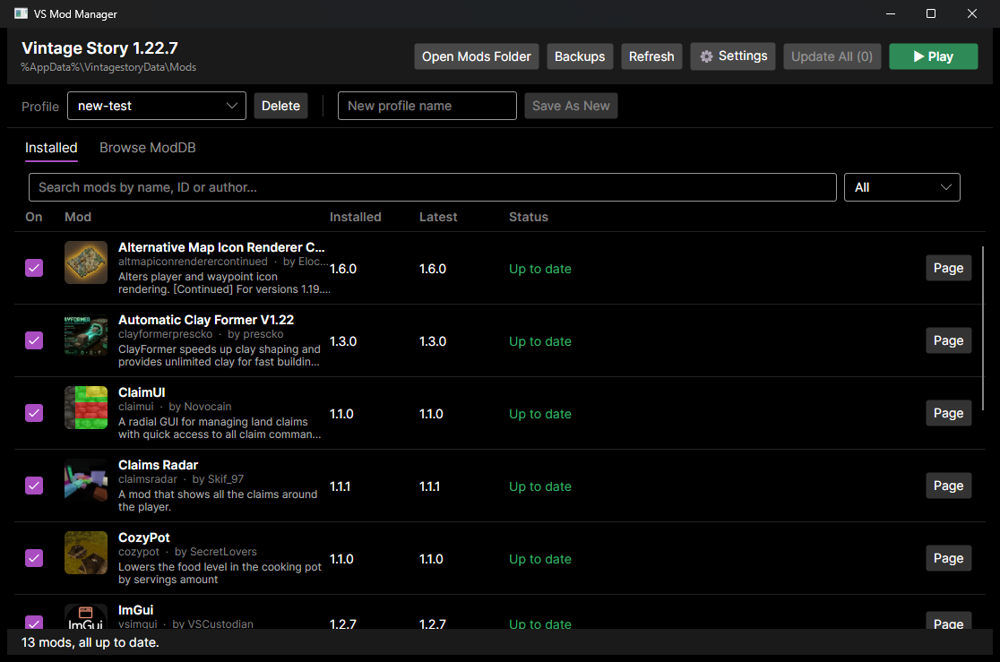
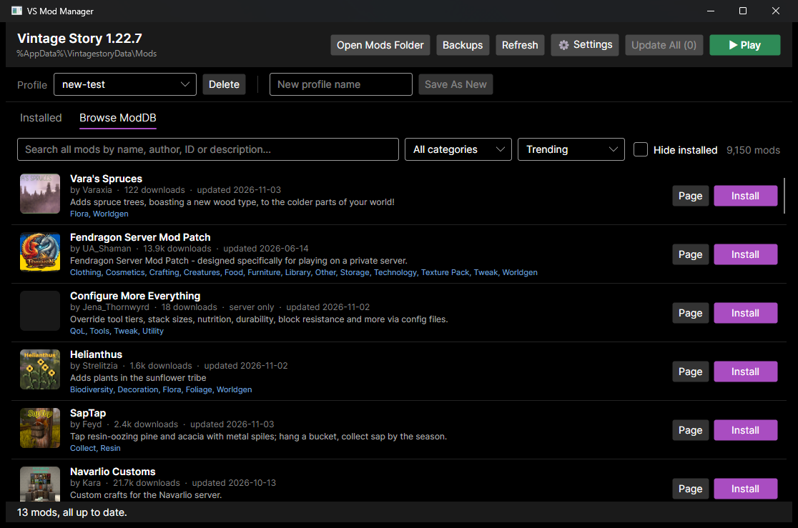

# VS Mod Manager

A desktop mod manager for [Vintage Story](https://www.vintagestory.at/), in the spirit of Gale and Vortex. It shows which of your mods have updates on the [official ModDB](https://mods.vintagestory.at/), updates them with one click, lets you browse and install new mods, and manages which mods are enabled, all without fighting the game's own settings.





## Features

- **Browse the ModDB.** Search all 9,000+ mods by name, author, ID or description, filter by category, sort by trending, downloads or recent updates, and install with one click. Dependencies come along automatically.
- **Icons and summaries.** Every mod shows its icon, author and a short description, from the mod itself or the ModDB.
- **Search and filter.** Find installed mods by name, ID or author, or narrow the list to mods with updates, problems, or that are disabled.
- **Update checks.** Every installed mod is looked up on the ModDB by its `modid`, and the newest release compatible with your game version is shown next to what you have.
- **One-click updates.** Update a single mod or all of them. Old files are never deleted; they're moved to a timestamped backup folder so you can roll back.
- **What's New.** Read the changelog for every release between your version and the latest before updating.
- **Dependency checks.** Flags mods that are missing a dependency, need a newer version of one, depend on a disabled mod, or need a newer game. **Fix Dependencies** installs or enables what's needed, including dependencies of dependencies.
- **Enable / disable.** Uses the game's own disabled-mod list, so the manager and the in-game mod screen always agree.
- **Profiles.** Save sets of enabled and disabled mods (e.g. "Vanilla+", "Full modpack") and switch between them from a dropdown.
- **Duplicate detection.** Spots when two versions of the same mod are installed and cleans up the older one.
- **Play button.** Launch the game from the manager. While it's running, mod changes are paused, and the list refreshes automatically when you quit.

## Download

Grab `VSModManager.exe` from the [Releases](https://github.com/Roanger/VS_Mod_Manager/releases) page and run it. It's a single self-contained file; no .NET install needed.

> Windows only for now. Avalonia is cross-platform, but the default paths and game detection assume Windows.

## Building from source

Requires the [.NET 9 SDK](https://dotnet.microsoft.com/download/dotnet/9.0).

```sh
git clone https://github.com/Roanger/VS_Mod_Manager.git
cd VS_Mod_Manager
dotnet run
```

To build a single-file exe into `publish/`:

```sh
dotnet publish -c Release -r win-x64 --self-contained true -p:PublishSingleFile=true -p:IncludeNativeLibrariesForSelfExtract=true -p:EnableCompressionInSingleFile=true -o publish
```

## How it works

| What | Where |
|---|---|
| Game install (version detected from `Vintagestory.exe`) | `%AppData%\Vintagestory` |
| Your mods | `%AppData%\VintagestoryData\Mods` |
| Enabled/disabled state | `disabledMods` in `%AppData%\VintagestoryData\clientsettings.json` |
| Backups of replaced mods and settings | `%AppData%\VintagestoryData\ModManagerBackups` |
| Profiles | `%AppData%\VSModManager\profiles.json` |
| Manager settings (custom folders) | `%AppData%\VSModManager\settings.json` |

The game and data folders above are the defaults. If you installed the game elsewhere or launch it with `--dataPath`, set your folders under **⚙ Settings**.

**Compatibility:** a release counts as compatible if it's tagged for your game's major.minor version (any `1.22.x` for game 1.22.7). ModDB tags rarely list every patch version, so an exact match would miss most mods.

**Editing game settings safely:** `clientsettings.json` is only modified while the game is closed (the game rewrites it on exit). Each edit re-reads the file first, changes only the disabled-mod list, writes atomically, and a backup is kept once per session.

**Profiles** store mod IDs without versions, so updating a mod never breaks a profile. Mods a profile doesn't mention are enabled, matching the game's default for newly added mods.

## Limitations

- Mods distributed as loose `.dll`/`.cs` files (no `modinfo.json`) are listed but can't be update-checked or toggled.
- The ModDB API doesn't expose a release's dependencies before download, so a dependency added by an update is flagged right after updating rather than before.

## Built with

- [Avalonia UI](https://avaloniaui.net/) 11
- [CommunityToolkit.Mvvm](https://github.com/CommunityToolkit/dotnet)
- [Newtonsoft.Json](https://www.newtonsoft.com/json)

Not affiliated with Anego Studios or the Vintage Story team.

## License

[MIT](LICENSE) © 2026 Roanger
